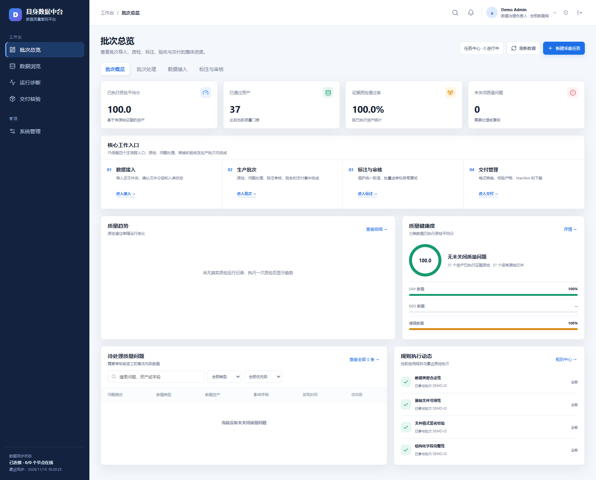
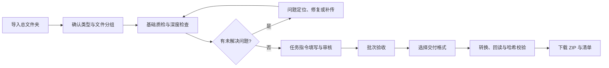
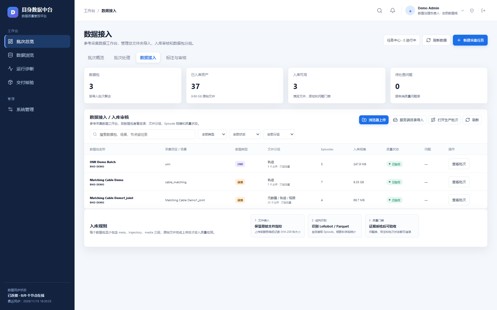
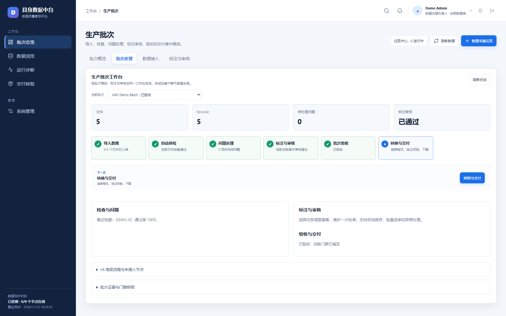
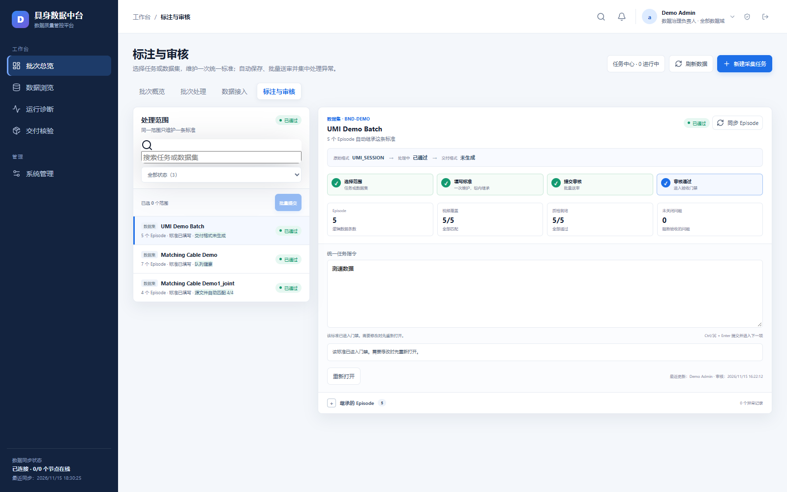
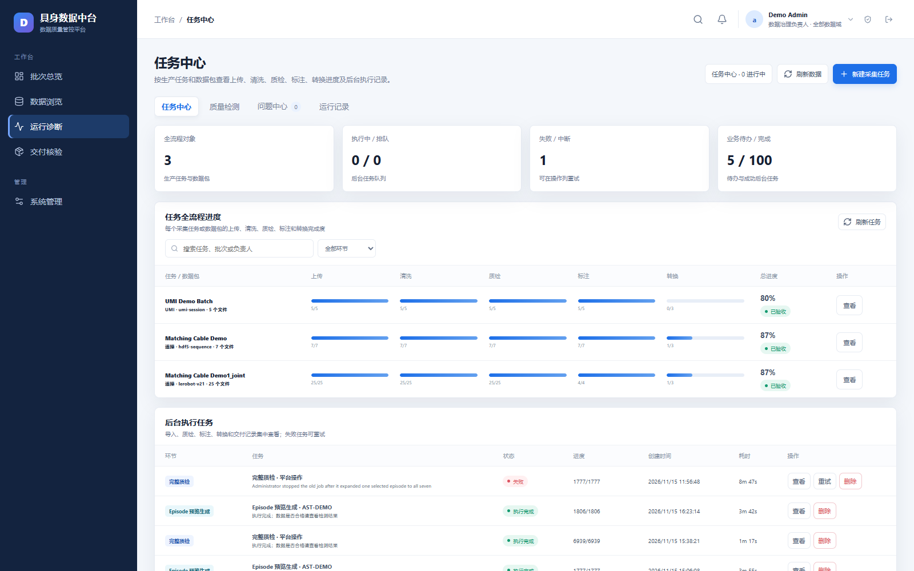
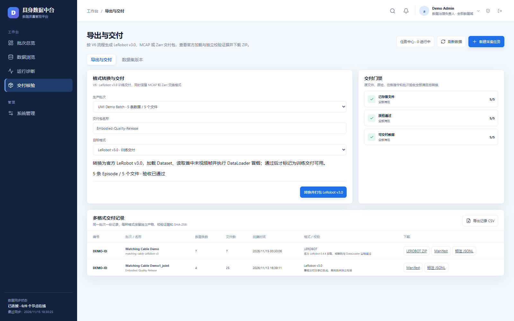
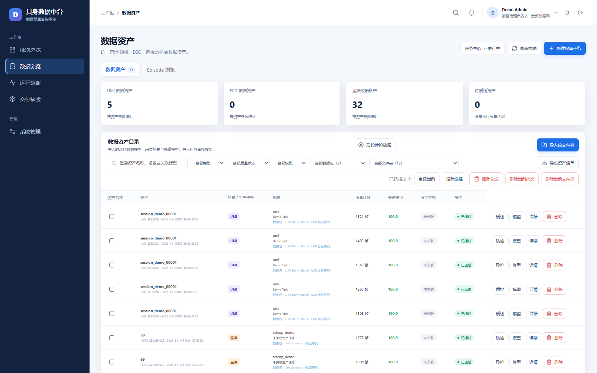
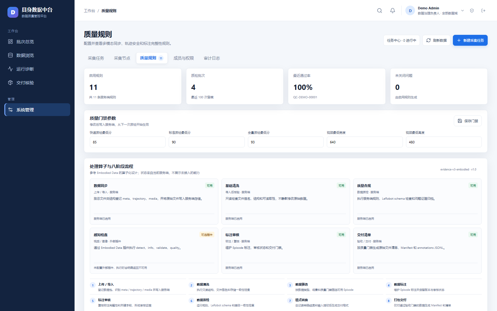
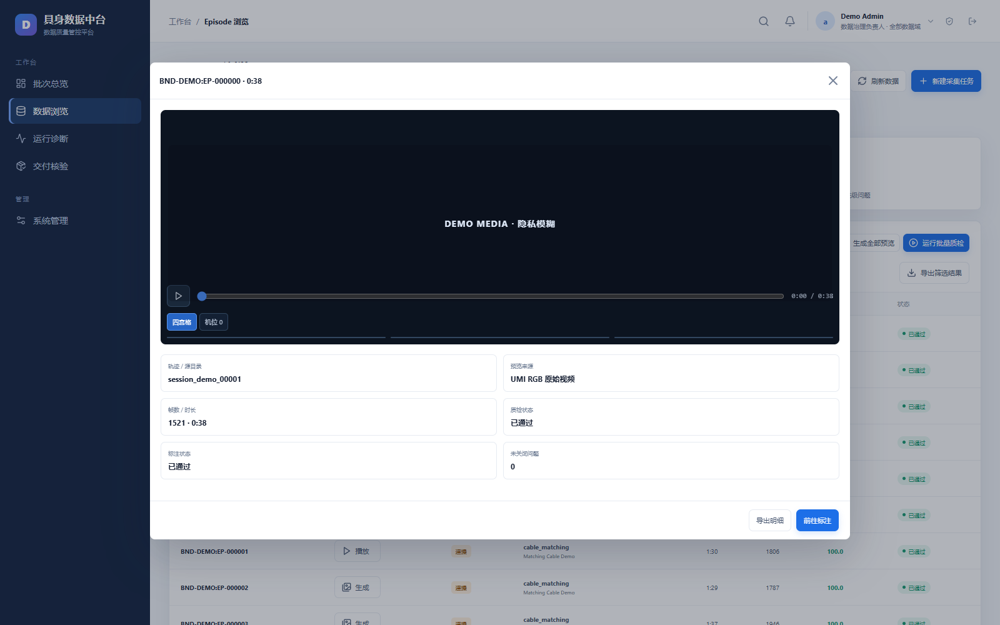

# Embodied Data Intelligence Processing Platform

**具身数据智能处理平台 · UMI / EGO / 遥操**

围绕一个生产批次，完成文件接入、质量检查、问题处置、任务指令审核、验收与多格式交付。

**Windows 本地 / 局域网运行 · Node.js 服务端 · Python 数据转换 · V6 流程模板**

**GitHub 稳定快照：`v3.6.3` · 2026-11-15 · 支持从 `1fb00bd` 快进升级**

[界面预览](#界面预览) · [本轮升级](#本轮升级) · [业务流程](#业务流程) · [快速开始](#快速开始) · [输出格式](#输出格式) · [升级旧版本](docs/UPGRADE.md) · [测试与证据](#测试与证据)

[](docs/screenshots/10-overview-current.png)

> 截图拍摄于 **2026-11-15**，来自当前版本实际运行界面。业务名称、账号、资产编号和视频画面已替换、隐藏或做隐私处理；仓库不包含生产数据、账号密码、`work/` 或 `runtime/`。

## 项目能做什么

| 工作环节 | 当前实现 |
| --- | --- |
| 文件夹接入 | 浏览器上传与服务端目录导入；自动识别 UMI Session、逐帧 HDF5、LeRobot、MCAP、Parquet 和三组数据包 |
| 批次工作台 | 聚合文件完整性、质检、问题、审核和验收门禁，并展示 V6 节点可用状态 |
| 质量检测 | 服务端规则检查、质检批次、问题证据；LeRobot / Parquet 深度检查需要 Python 环境 |
| 问题处理 | 按资产定位检测项，分配处置、填写说明、执行复检；保留问题状态与处理记录 |
| 标注与审核 | 自动解析 `annotations.jsonl`、LeRobot `episodes.jsonl` / `tasks.jsonl` 并按 Episode 继承；未覆盖范围才进入“选择范围 → 统一标准 → 批量送审 → 异常处理/审核” |
| 任务中心 | 按生产任务或数据包展示上传、清洗、质检、标注、转换全流程进度，同时保留后台执行任务、业务待办、失败重试和执行日志 |
| Episode 预览 | HDF5 四路同步预览；UMI 将浏览器不兼容的 `mpeg4` 按需转码为 H.264 单机位预览 |
| 多视角验收 | 从数据集声明或目录提取相机集合，逐 Episode 检查轨迹与视频对应关系 |
| 格式转换与交付 | 在已验收批次上生成 LeRobot v3.0 训练交付，并用官方 LeRobot 0.4.4 Dataset 与 DataLoader 验证；同时保留 MCAP、Zarr v2 交换格式 |
| 大型 HDF5 遥操包 | 服务端目录导入按 Episode 聚合逐帧 HDF5，不把每帧登记成资产；支持直接映射为 LeRobot v3.0 |
| TeleUMI Session | 每个 `session_*` 聚合成一个 Episode，检查 RGB/VIVE/夹爪频率、时间戳、同步、四元数和夹爪范围 |
| 高速小文件传输 | 批量创建上传任务、轻量分片请求、1,000 文件批量校验入库；登记上限 20,000 个资产 |
| 账号与权限 | 本地登录、角色和数据域限制、所有者控制删除授权；受保护操作由服务端鉴权 |

## 业务流程



以**批次**组织生产，以 **Episode** 统计逻辑数据条数。一份轨迹及其全部声明相机视频属于同一条 Episode，不按 MP4 文件数重复计数。任务指令按任务 / 数据集审核一次，交付时展开到各 Episode。标注工作台支持草稿自动保存、批量送审、异常范围筛选和“下一个待处理”，并展示 `原始格式 → 处理中 → 交付格式` 链路。记录级异常复核只保存人工结论、标签和意见，不自动关闭质量问题或放宽验收门禁。

总览只保留“数据接入、生产批次、标注与审核、交付管理”四个主入口；生产批次内的阶段只展示进度，不重复提供跳转按钮。标注页的保存已并入提交，提交或审核后自动进入下一项，任务详情与执行日志合并为一个查看入口。

平台使用 **V6 模板**展示后续扩展路径。融合、脱敏、去畸变、位姿、语义等尚未接入的节点显示为“未接入”；当前已实现的业务路径与完整 V6 算法流水线应分别看待。V5 与配音分支不纳入新流程。

## 本轮升级

从上一发布快照 `1fb00bd` 到当前稳定快照，主要变化如下：

- **统一导航**：日常入口收敛为“批次总览、数据浏览、运行诊断、交付核验、系统管理”，旧页面保留为工作区二级标签。
- **TeleUMI 接入**：服务端目录导入自动把 `session_*` 聚合为 Episode，保留源文件位置和清单指纹；重复导入返回已登记结果，不再误报只识别第一项。
- **UMI 专用质检**：核对 RGB 视频帧数、40 FPS 时间轴、VIVE 约 120 Hz、夹爪约 60 Hz、首尾同步、四元数范数、夹爪 0–100 范围和 NaN/Inf。
- **UMI 原生交付**：按 RGB 时间戳同步 VIVE 位姿和夹爪值，生成 8 维 `observation.state`，`action` 使用下一帧状态，直接创建官方 LeRobot v3.0。
- **浏览器兼容预览**：源 UMI 视频编码为 `mpeg4` 时，按需转为 H.264；现有 5 条验证数据为 640×480、40 FPS，帧数与源视频一致。
- **HDF5 交付闭环**：逐帧 HDF5 目录直接生成四路 LeRobot 视频、训练字段、官方加载报告、独立验包和 ZIP。
- **小文件吞吐优化**：增加 6 文件并发、批量创建上传会话、轻量分片写入、1,000 文件批量完成和 gzip 响应；11,879 个元数据登记压测约 2 秒。
- **任务中心完善**：上传、质检、标注、转换和交付进度统一展示；未完成上传支持暂停、继续和删除。
- **数据兼容保留**：旧 SQLite 数据原位迁移；`work/`、`runtime/` 不参与源码更新；升级前可自动创建数据库备份。

## 界面预览

图片直接内嵌在 GitHub 首页；**点击任意截图查看原图**。页面来自当前版本真实浏览器运行结果，账号、业务名称、资产编号和视频画面已清洗。

| ① 批次总览 | ② 数据接入 |
| --- | --- |
| [](docs/screenshots/10-overview-current.png) | [](docs/screenshots/11-intake-current.png) |
| 批次概览、质量健康度、待处理问题和四个核心工作入口。 | 服务端目录导入、批次聚合、入库规模和验收状态。 |

| ③ 生产批次 | ④ 标注与审核 |
| --- | --- |
| [](docs/screenshots/12-production-current.png) | [](docs/screenshots/13-annotation-current.png) |
| 当前批次门禁、文件 / Episode 数量、问题与下一步操作。 | 标注标准、5/5 Episode 覆盖、5/5 视频覆盖和待处理问题。 |

| ⑤ 任务中心 | ⑥ 交付核验 |
| --- | --- |
| [](docs/screenshots/15-jobs-current.png) | [](docs/screenshots/16-delivery-current.png) |
| 上传、清洗、质检、标注、转换进度与后台执行记录。 | LeRobot v3.0、MCAP、Zarr、官方加载、独立验包和打包下载。 |

| ⑦ 数据浏览 | ⑧ 系统管理 |
| --- | --- |
| [](docs/screenshots/14-assets-current.png) | [](docs/screenshots/18-system-management-current.png) |
| UMI Session、遥操 HDF5 与 LeRobot 资产的筛选、质检和批量操作。 | 质量门禁、八阶段流程、规则库、成员权限与审计入口。 |

### UMI 播放

[](docs/screenshots/17-umi-playback-current.png)

UMI 原始采集视频使用 `mpeg4`，浏览器不能稳定播放，平台会按需转码为 H.264。截图保留播放器、时长、帧数和质检信息，真实视频画面已隐藏并替换为演示遮罩。

## 快速开始

### 1. 获取源码并启动

需要 Windows 10/11、Node.js 22.13+（推荐 Node.js 24 LTS） 和 PowerShell 5.1+。仓库不打包 Node / Python 运行时，首次使用请先安装所需环境。

```powershell
git clone https://github.com/DDDB479/embodied-data-intelligence-processing-platform.git
cd embodied-data-intelligence-processing-platform
node .\serve.js
```

浏览器打开 [http://localhost:4173/](http://localhost:4173/)，首次启动创建自己的管理员账号。仓库没有可用于业务登录的默认账号或默认密码。

日常使用可双击 `启动平台.bat`；启动器通过 `platform-service.ps1` 检查和维持本机服务。开机启动、局域网访问和故障定位见[操作说明](docs/OPERATIONS.md)。

### 从旧版本升级

当前稳定快照可以直接覆盖上一发布版本 `1fb00bd`，不会修改 `work/` 中的业务数据，也不会覆盖本地 `runtime/`。不熟悉命令行的用户，在仓库目录中双击 `更新平台.bat` 即可；窗口会在完成或失败后停留，方便查看结果。

```powershell
powershell.exe -NoProfile -ExecutionPolicy Bypass -File .\update-platform.ps1
```

双击入口会调用同一个更新脚本：检查本地源码是否干净、备份 SQLite、快进拉取 `origin/main`、同步依赖、重启服务并等待健康检查。旧版本第一次升级时，需要先取得当前仓库中的双击入口：

```powershell
git pull --ff-only origin main
```

拉取完成后双击 `更新平台.bat`。以后有稳定更新时仍可继续使用这个入口。

详细的数据保留、依赖同步、验证和回滚步骤见[升级指南](docs/UPGRADE.md)。

### 2. 启用 Parquet 校验与格式转换

使用 Python 3.12 建立转换环境，并安装转换依赖：

```powershell
py -3.12 -m venv runtime\python
.\runtime\python\Scripts\python.exe -m pip install -r tools\requirements-delivery.txt
```

LeRobot v3.0 交付需要独立锁定环境。安装 `uv` 后执行：

```powershell
$env:UV_PROJECT_ENVIRONMENT = (Join-Path $PWD 'runtime\lerobot')
uv sync --project tools\lerobot-runtime --locked
```

该环境固定为 LeRobot 0.4.4、Torch 2.7.1 CPU、Torchvision 0.22.1、PyAV 15.1.0 和 datasets 4.1.1。安装后重新启动服务。平台会查找 `runtime/python/Scripts/python.exe` 与 `runtime/lerobot/Scripts/python.exe`；自定义路径可以分别通过 `LEROBOT_PYTHON` 和 `LEROBOT_OFFICIAL_PYTHON` 指定。外部 Embodied Data 插件属于可选集成，不包含在本仓库中，配置见[引擎集成说明](tools/EMBODIED_INTEGRATION.md)。

### 3. 导入自己的数据集

在“数据接入”中选择**总文件夹**，例如：

```text
demo_teleoperation/
├── annotations.jsonl
├── meta/
│   ├── info.json
│   ├── episodes.jsonl
│   └── tasks.jsonl
├── data/chunk-000/
│   └── episode_000000.parquet
└── videos/chunk-000/observation.images.head/
    └── episode_000000.mp4
```

目录示意不是 LeRobot 必需文件的完整清单。平台会识别分组；数据类型仍需按采集方式确认，不能仅凭文件扩展名认定 UMI、EGO 或遥操。随后执行质检并处理问题。源数据已有标注时平台会自动解析，只有未覆盖的 Episode 才需要提交人工任务指令；全部门禁通过后验收并交付。

数据包预设会根据文件扩展名、目录结构和 `meta` / `data` / `video` 分组自动选择。例如选择遥操类型并导入 `.h5` / `.hdf5` 文件时，会自动匹配“HDF5 轨迹 / 传感器数据包”；LeRobot、MCAP、Parquet、结构化数据和媒体包也各有匹配规则。自动结果会显示置信度和判断依据，用户仍可从下拉框手动切换；手动选择会保持覆盖，选择“自动识别”后恢复联动。

### 大型逐帧 HDF5 目录

当一条 Episode 被拆成上千个逐帧 `.hdf5` 文件时，不要使用浏览器逐文件上传。进入“数据接入 → 服务端目录导入”，填写部署电脑上的总目录，例如：

```text
E:\遥操数据\matching_cable\
├── matching_cable\68\0.hdf5 ... 1776.hdf5
├── matching_cable\69\0.hdf5 ... 1805.hdf5
└── ... 74
```

平台把每个包含 HDF5 帧的目录登记为一个 Episode，源文件保留在原位置，不复制出第二份 10 GB 数据。浏览器通道检测到超过 200 个纯 HDF5 文件时会阻止逐文件登记，避免生成上万个资产和上传会话。

在“Episode 浏览”中点击“生成”或“生成全部预览”，平台会从原始 HDF5 读取四路 RGB，生成 640 宽的四路 H.264 预览和首中末缩略图。生成任务使用平台唯一后台 worker，同一时间只编码一个 Episode；缓存位于 `work/previews/<资产编号>/<源指纹>/`，源文件变化后自动失效。页面默认四宫格同步播放，移动端自动切换单机位，视频接口支持 HTTP Range。

`matching_cable` 预设按 `master/joint_position` → `action`、`puppet/joint_position` → `observation.state` 映射。四路 RGB 转为视频，两路深度图执行可解码校验；跨帧时间戳、NaN/Inf、关节维度与重复时间戳会进入质检证据。通过门禁和审核后可直接生成官方 LeRobot v3.0，不再依赖外部 Embodied Data 转换插件。

### TeleUMI Session 目录

TeleUMI 数据使用“数据接入 → 服务端目录导入”，选择数据类型 `UMI`。平台自动识别包含 `single_hand` 的 `session_*` 目录，每个 session 登记为一个 Episode，源文件保留在原位置。必需结构包括：

```text
session_*/
├── Metadata/ui_backend_metadata.json
└── single_hand/
    ├── Metadata/{metadata,pc_metadata,pc_joint_metadata}.json
    ├── RGB_Images/{video.mp4,timestamps.csv}
    ├── Merged_Trajectory/{merged_trajectory.txt,vut_raw.csv}
    └── Clamp_Data/{clamp_timebase.csv,clamp_data_tum.txt}
```

UMI 质检会核对 RGB 帧数与视频解码帧数、相机/VIVE/夹爪采样频率、时间戳单调性、跨传感器首尾同步、四元数范数、夹爪 0–100 范围和视频黑屏/冻结候选。交付时按 RGB 时间戳同步 VIVE 位姿和夹爪值，生成 `observation.state=[x,y,z,qx,qy,qz,qw,gripper]`，`action` 使用下一帧状态，并直接创建官方 LeRobot v3.0 数据集。

入库所需文件组由预设决定，不再要求所有格式都包含 `meta`、`trajectory`、`media`：LeRobot v2.1 和标准三组包要求三组齐全，HDF5、MCAP、Parquet、结构化及媒体包按各自预设判断。已登记资产的全部原始文件上传完成后才开放质检。数据资产页支持勾选、全选当前筛选结果，以及按数据包或文件夹直接批量删除。

> GitHub 展示源码与截图，不运行本项目的认证、上传或转换服务。`localhost` 仅指向当前电脑；让另一台电脑使用平台，需要在部署电脑运行服务并配置局域网访问。

### 4. 已有标注自动导入

平台会在每批文件上传完成后自动解析源文件内容，不只执行文件签名和结构质检。以下来源均可自动生成 Episode 标注并跳过人工填写：

- 根目录或 `meta/` 下的 `annotations.jsonl`，每条至少包含 `episode_index` 和 `instruction`、`task_instruction` 或 `task`。
- LeRobot 标准 `meta/episodes.jsonl`，使用 `episode_index` 与 `tasks` / `task`。
- LeRobot 标准 `meta/tasks.jsonl`，结合 Parquet 中的 `task_index` 自动映射到各 Episode。

平台会校验 JSONL 每一行、Episode 编号、任务内容和源文件 SHA-256。全部 Episode 匹配成功时，标注状态直接进入“已通过”并解除人工标注门禁；只覆盖部分 Episode 时，仅未覆盖记录进入人工队列。解析失败会绑定源文件证据并阻断相关批次，不会伪造通过结果。

同一数据集允许不同 Episode 使用不同指令。LeRobot 或 MCAP/Zarr 交付时会按指令重建规范化的 `task_index`，并同步改写 LeRobot Parquet 列，避免多个指令共用同一个任务索引造成交付冲突。

### 数据质检范围

文件存在、SHA-256、签名和容器结构属于基础完整性检查，不等同于数据质量通过。当前服务端额外执行：

- LeRobot Parquet 必需列、向量维度、NaN/Inf、时间戳与帧号连续性、Episode 混写和 FPS 采样间隔检查。
- 视频逐帧解码、分辨率、时间戳、黑屏/冻结候选，以及视频时长与轨迹行数的一致性检查。
- 遥操 HDF5 的主从关节、末端位姿、力通道、时间戳、4 路 RGB JPEG、2 路深度 PNG 和跨文件时序缺口检查；`puppet/6f` 在 `teleop-hdf5-v1` 中按可选通道处理，缺失或恒零不判为数据缺陷。
- 同类 HDF5 文件问题按批次、采集会话和规则聚合成一个问题单，保留影响文件数，不再为每个文件重复生成相同问题。

“解析器缺失”或“质检能力未覆盖”会标记为待质检阻塞，不会扣减数据分或生成数据缺陷。HDF5 未提供关节单位、相机标定等元数据时，平台会记录质检限制，不会把未验证项伪造成 100 分。

## 输出格式

| 格式 | 实际产物 | 兼容范围 |
| --- | --- | --- |
| **LeRobot v3.0** | 官方 v3.0 目录、审核后的指令、官方加载验证报告、独立验包报告 | 官方 LeRobot 0.4.4 `LeRobotDataset` 可加载，并通过首中末帧解码与 DataLoader 冒烟 |
| **MCAP** | 每 Episode 一个 `.mcap`，写入原时间戳的 JSON 轨迹消息；视频随 ZIP 独立保留并由相对路径关联 | `embodied-json` profile；不是 ROS/ROS2 bag，不包含解码图像话题 |
| **Zarr v2** | 每 Episode 一个 group；数值列为数组，其余列为带编码说明的 JSON 字符串；视频随包保留 | 本项目的列数组布局，接入训练框架时需核对字段与布局 |

LeRobot v2.1 源包会物化为官方 v3.0；逐帧 HDF5 和 UMI Session 使用各自原生适配器直接创建官方 LeRobot v3.0。所有 LeRobot 交付只有在官方 LeRobot 0.4.4 Dataset 加载、视频帧解码、DataLoader batch 冒烟和独立解包验包全部通过后才可下载。MCAP / Zarr 从 LeRobot v2.1 工作目录生成，并通过全列回读、视频解码、ZIP CRC 和整包 SHA-256 校验；它们不是机器人策略训练格式的兼容性承诺。

同一批次的一份交付记录可以附加多种格式。源文件、任务指令或验收状态改变后，服务端阻止下载失效的转换包；源文件与基础快照不一致时，需要重新建立有效的交付版本。

## 测试与证据

| 检查内容 | 代码与证据 |
| --- | --- |
| 指令保存、提交、审核、退回及角色约束 | [标注接口测试](tests/annotation-api.test.js)、[标注业务测试](tests/annotation-workflow.test.js) |
| Episode 多视角、审核与验收门禁 | [工作流门禁测试](tests/workflow-gates.test.js)、[工作流接口测试](tests/workflow-api.test.js) |
| 三种格式生成、官方 LeRobot v3.0 验证、下载、重复复用、权限与旧包失效 | [交付接口测试](tests/delivery-api.test.js) |
| 官方加载、DataLoader、轨迹回读、缺视角 / 时间戳倒序拒绝 | [转换器测试](tests/test_delivery_convert.py)、[官方验证器](tools/official_lerobot.py) |
| TeleUMI Session 聚合、时序质检、标注验收与 LeRobot v3.0 交付 | [UMI 导入测试](tests/umi-session-import.test.js)、[UMI 交付测试](tests/umi-session-delivery.test.js)、[UMI 转换器测试](tests/test_umi_convert.py) |

2026-11-15 本地复核结果：**56 项 Node 测试 + 15 项 Python 测试通过**，官方 LeRobot 0.4.4 环境中的 UMI→v3.0 和 HDF5 四路预览测试通过；另用真实 5 条 UMI 数据完成 5 个 Episode、6,939 帧转换和独立 ZIP 验包。测试与结构验证不代表具体训练效果已经验收。

```powershell
node --check serve.js
node --check assets\extensions.js
node --test tests/*.test.js
.\runtime\python\Scripts\python.exe -m unittest discover -s tests -p test_delivery_convert.py -v
.\runtime\python\Scripts\python.exe -m unittest discover -s tests -p test_production_check.py -v
```

## 数据存储与部署范围

### 大文件传输

浏览器导入默认并发上传 6 个文件，单个文件默认使用 16 MiB 分片。平台先批量创建上传会话，分片请求不再解析整份业务状态；完成后按 1,000 个文件批量校验和入库。服务重启后可从最后一次清单检查点继续，完成时生成整文件 SHA-256 并直接接管临时文件。

局域网部署可在启动服务前设置 `UPLOAD_CHUNK_SIZE_MB` 调整分片，允许范围为 1 到 64 MiB，例如 `$env:UPLOAD_CHUNK_SIZE_MB = 16`。数据包 ZIP 下载支持 HTTP Range，可断点续传；下载前不再同步扫描整个 ZIP 计算哈希，而是使用转换阶段登记的整包 SHA-256、大小和 ETag。

任务中心统一显示上传、质检、转换、交付、备份和复检任务。上传任务可按文件暂停、继续和删除；暂停在当前分片完成后停止发送，继续时从服务端已确认偏移恢复，删除会清理未完成分片。运行中的质检或转换属于不可安全挂起的进程，平台只允许暂停排队任务和删除未运行任务。

- 原始文件、认证状态、质检记录和交付包保存在部署电脑的 `work/` 中；`work/`、`runtime/`、日志和缓存已加入 Git 忽略规则。
- ZIP 与资产下载经过服务端认证和权限检查，`work/` 与 `.git/` 不作为静态文件公开。
- 当前使用 SQLite WAL 事务保存业务、账号、上传会话和后台任务，原始文件单独落盘；支持完整备份及恢复到空目录。仍是单机部署，尚未验证多实例或高并发负载，互联网部署需单独配置 TLS 与网关。
- 本轮生产升级、续传、检查依据与恢复步骤见 [生产升级说明](docs/PRODUCTION_UPGRADE.md)。
- V6 的融合、脱敏、位姿、语义标注等完整算法链路仍待接入。按钮、模板进度或界面截图不等于这些算法已实现。

## 项目结构

```text
├── serve.js                       # 本地 HTTP 服务、认证、质检与业务接口
├── index.html                     # 主界面
├── assets/                        # 业务交互与样式
├── tools/
│   ├── delivery_convert.py         # 多格式转换与回读验证
│   ├── lerobot_schema_check.py     # Parquet / LeRobot 字段校验
│   ├── create-db-backup.js          # 升级前 SQLite 一致性备份
│   └── requirements-delivery.txt   # Python 转换依赖
├── tests/                         # 工作流、权限与转换测试
├── docs/
│   ├── screenshots/               # 当前版本实拍界面
│   ├── SCREENSHOTS.md              # 截图来源与隐私处理
│   ├── UPGRADE.md                  # 旧版本升级、验证与回滚
│   └── OPERATIONS.md               # 操作与部署说明
├── 更新平台.bat                    # 双击更新入口
├── update-platform.ps1              # 备份、快进更新、依赖同步与服务重启
├── platform-launcher.ps1            # 启动与健康检查
└── platform-service.ps1            # Windows 服务维持脚本
```

## 参考与致谢

仓库首页借鉴 [Embodied-AI-Data-Processing-Platform](https://github.com/MAHONGHAO1/Embodied-AI-Data-Processing-Platform) 的“业务流程 + 内嵌截图 + 验证证据 + 启动说明”组织方式。截图与实现来自本项目；LeRobot v3.0 能力由本仓库固定的官方 0.4.4 运行时、验证报告和本地回归测试证明。
