# Embodied Data Intelligence Processing Platform

**具身数据智能处理平台 · UMI / EGO / 遥操**

围绕一个生产批次，完成文件接入、质量检查、问题处置、任务指令审核、验收与多格式交付。

**Windows 本地 / 局域网运行 · Node.js 服务端 · Python 数据转换 · V6 流程模板**

[界面预览](#界面预览) · [业务流程](#业务流程) · [快速开始](#快速开始) · [输出格式](#输出格式) · [测试与证据](#测试与证据) · [操作说明](docs/OPERATIONS.md)

[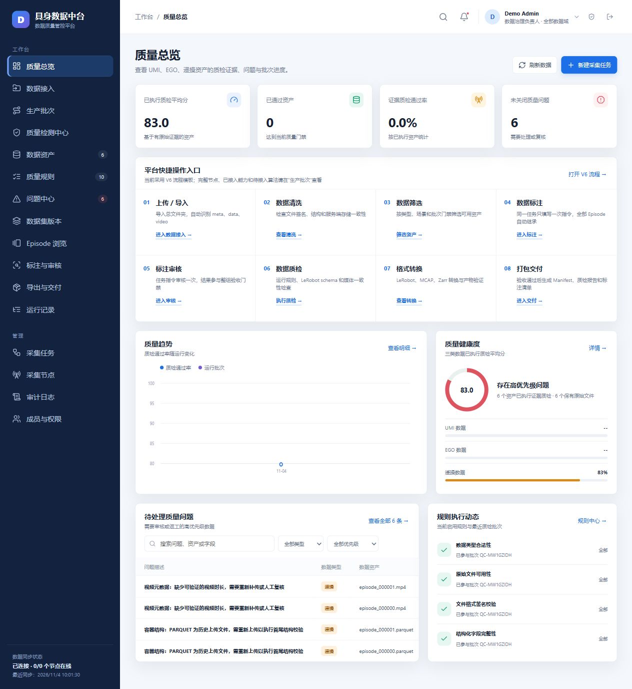](docs/screenshots/00-overview.jpg)

> 截图拍摄于 **2026-11-04**，来自本项目实际运行的界面，使用隔离的合成测试样本与测试账号。截图中的业务状态不代表真实采集数据验收；质检与交付专项展示的来源和范围见[截图说明](docs/SCREENSHOTS.md)。仓库不包含生产数据、业务账号或运行时目录。

## 项目能做什么

| 工作环节 | 当前实现 |
| --- | --- |
| 文件夹接入 | 选择数据集总目录，按路径识别 `meta`、`data`、`video/videos`；人工确认 UMI、EGO 或遥操类型 |
| 批次工作台 | 聚合文件完整性、质检、问题、审核和验收门禁，并展示 V6 节点可用状态 |
| 质量检测 | 服务端规则检查、质检批次、问题证据；LeRobot / Parquet 深度检查需要 Python 环境 |
| 问题处理 | 按资产定位检测项，分配处置、填写说明、执行复检；保留问题状态与处理记录 |
| 指令标注与审核 | 一个采集任务或数据集填写一次指令，组内 Episode 继承；支持提交、退回、审核及重新打开 |
| 多视角验收 | 从数据集声明或目录提取相机集合，逐 Episode 检查轨迹与视频对应关系 |
| 格式转换与交付 | 在已验收批次上生成 LeRobot v2.1、MCAP、Zarr v2 产物，提供 ZIP、Manifest 与标注 JSONL |
| 账号与权限 | 本地登录、角色和数据域限制、所有者控制删除授权；受保护操作由服务端鉴权 |

## 业务流程

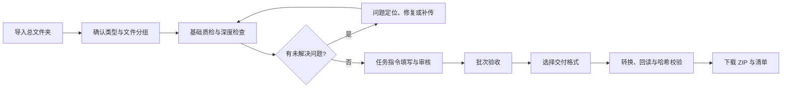

以**批次**组织生产，以 **Episode** 统计逻辑数据条数。一份轨迹及其全部声明相机视频属于同一条 Episode，不按 MP4 文件数重复计数。任务指令按任务 / 数据集审核一次，交付时展开到各 Episode。

平台使用 **V6 模板**展示后续扩展路径。融合、脱敏、去畸变、位姿、语义等尚未接入的节点显示为“未接入”；当前已实现的业务路径与完整 V6 算法流水线应分别看待。V5 与配音分支不纳入新流程。

## 界面预览

图片直接内嵌在 GitHub 首页；**点击任意截图查看原图**。页面数据均为隔离测试样本，未使用业务数据截图。

| ① 数据接入 | ② 生产批次 · V6 |
| --- | --- |
| [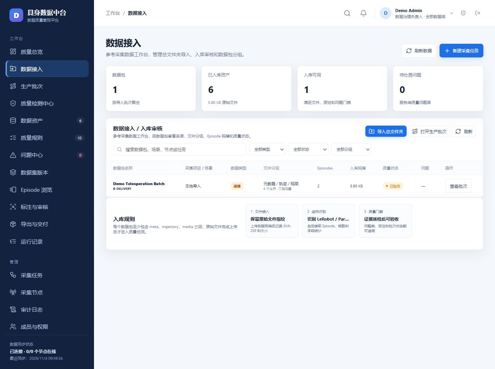](docs/screenshots/01-intake.jpg) | [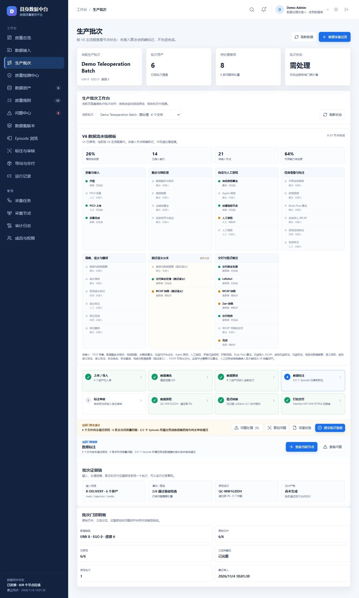](docs/screenshots/02-production.jpg) |
| 总文件夹导入入口、文件分组、Episode 数量与入库状态。 | 当前批次、问题阻断、验收入口与已接入 / 未接入节点。 |

| ③ 质量检测中心 | ④ 问题中心 |
| --- | --- |
| [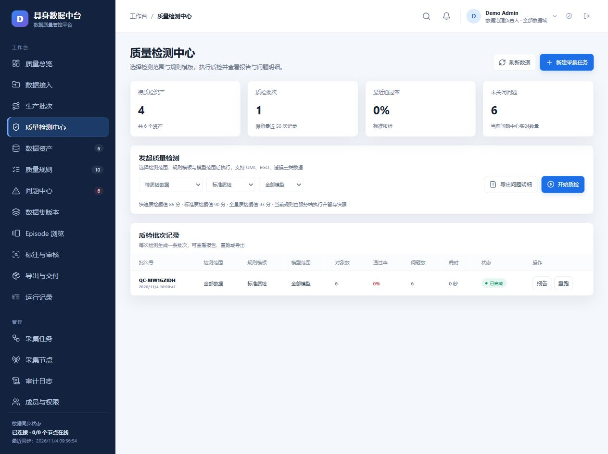](docs/screenshots/03-quality.jpg) | [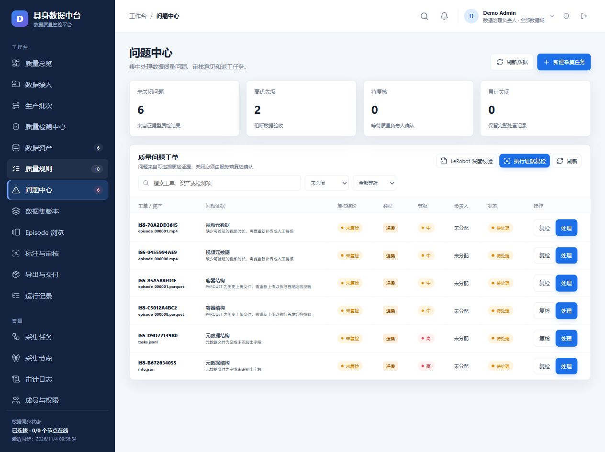](docs/screenshots/04-issues.jpg) |
| 对隔离样本实际执行检查，保留 0% 通过率与 6 项问题。 | 展示缺少解析证据等待处理问题，保留失败结果。 |

| ⑤ 任务指令标注与审核 | ⑥ 规则与质量门禁 |
| --- | --- |
| [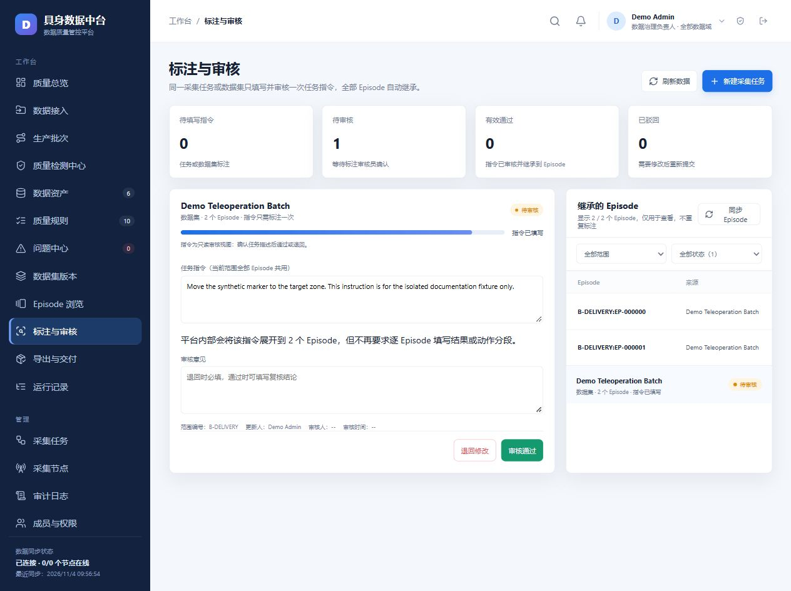](docs/screenshots/05-annotation.jpg) | [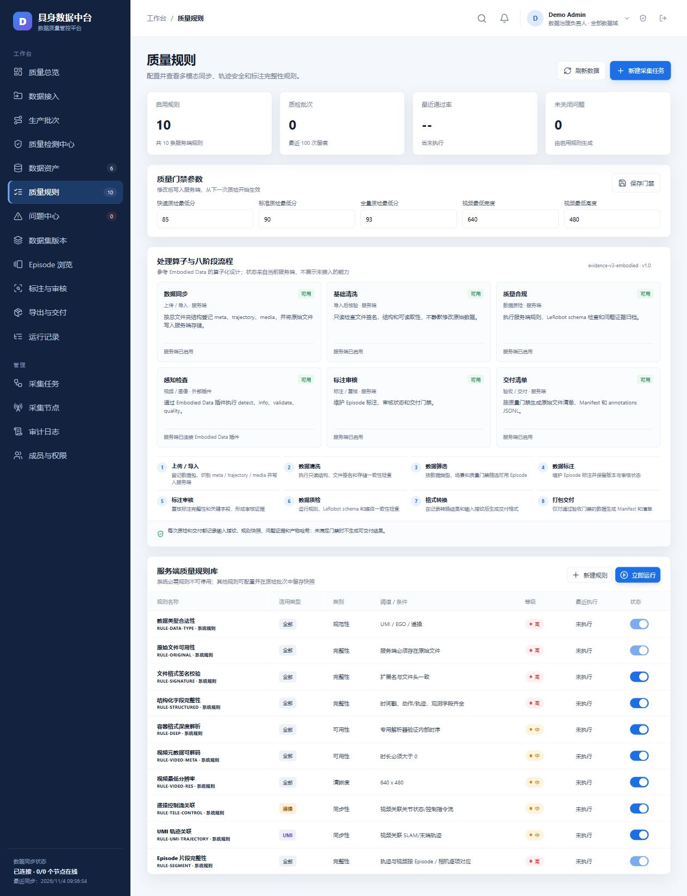](docs/screenshots/06-rules.jpg) |
| 同一任务指令覆盖组内 Episode；审核时只读确认或退回。 | 查看评分阈值、启用规则和当前服务端能力。 |

| ⑦ 格式转换与交付 | ⑧ 成员与权限 |
| --- | --- |
| [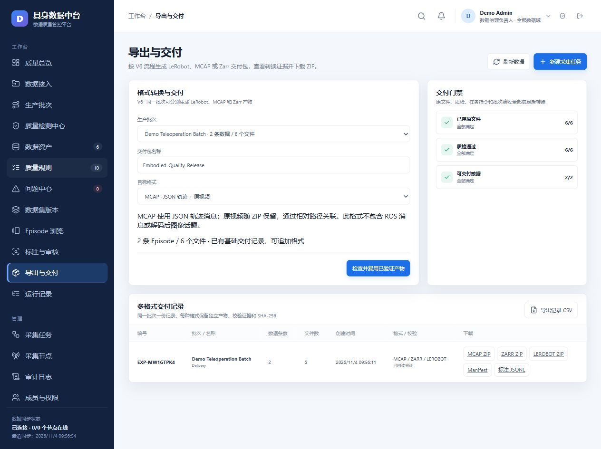](docs/screenshots/07-delivery.jpg) | [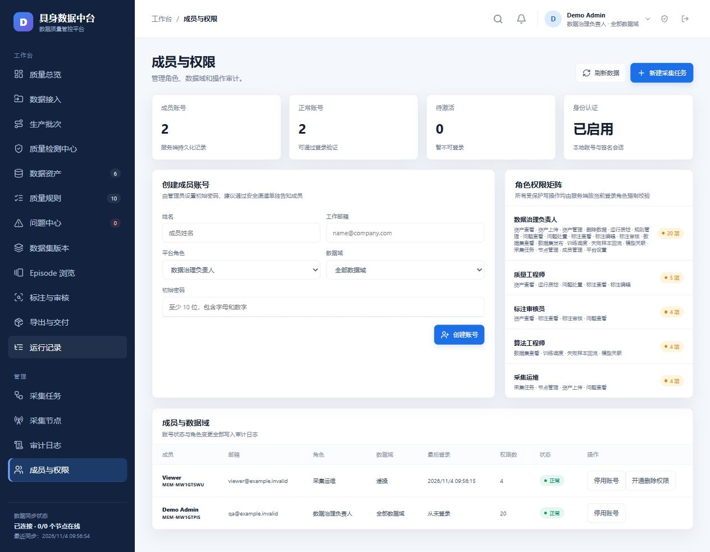](docs/screenshots/08-permissions.jpg) |
| 转换专项测试的三种产物、回读验证结果和下载入口。 | 隔离测试账号、角色权限矩阵与所有者删除授权入口。 |

### 运行证据

[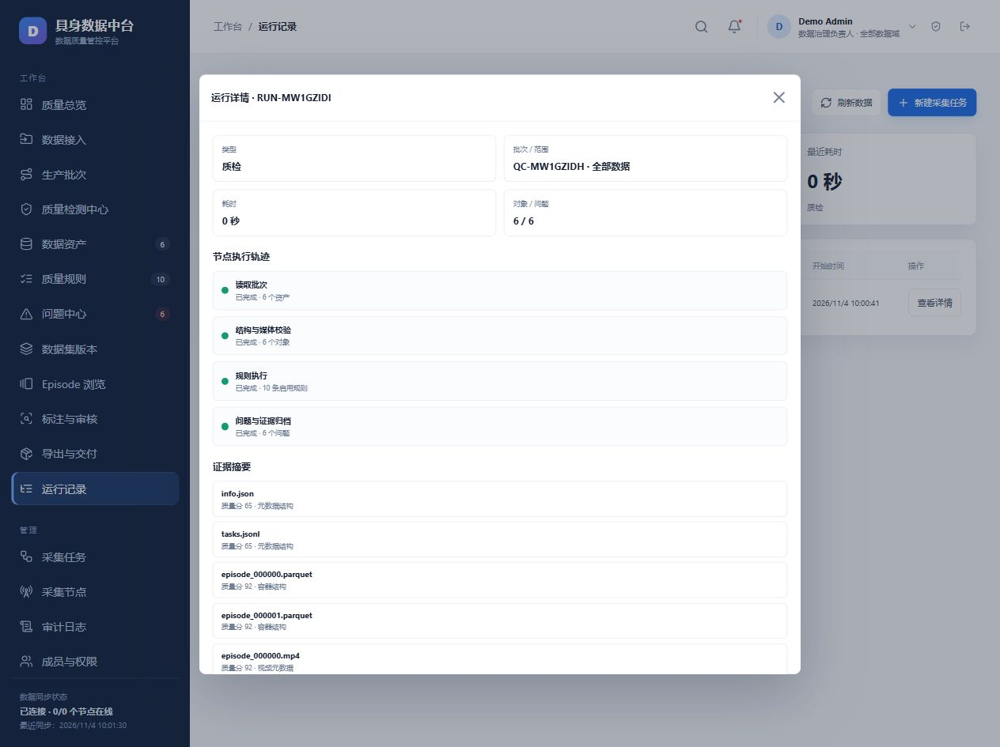](docs/screenshots/09-runs.jpg)

“运行完成”表示检查程序已执行，不等于数据全部合格。示例运行完成后仍有 6 项待处理问题；批次需继续处理，不能据此视为验收通过。

## 快速开始

### 1. 获取源码并启动

需要 Windows 10/11、Node.js 18+ 和 PowerShell 5.1+。仓库不打包 Node / Python 运行时，首次使用请先安装所需环境。

```powershell
git clone https://github.com/DDDB479/embodied-data-intelligence-processing-platform.git
cd embodied-data-intelligence-processing-platform
node .\serve.js
```

浏览器打开 **http://localhost:4173/**，首次启动创建自己的管理员账号。仓库没有可用于业务登录的默认账号或默认密码。

日常使用可双击 `启动平台.bat`；启动器通过 `platform-service.ps1` 检查和维持本机服务。开机启动、局域网访问和故障定位见[操作说明](docs/OPERATIONS.md)。

### 2. 启用 Parquet 校验与格式转换

使用 Python 3.12 建立环境，并安装转换依赖：

```powershell
py -3.12 -m venv runtime\python
.\runtime\python\Scripts\python.exe -m pip install -r tools\requirements-delivery.txt
```

安装后重新启动服务。平台会查找 `runtime/python/Scripts/python.exe`；自定义 Python 路径可以通过 `LEROBOT_PYTHON` 环境变量指定。外部 Embodied Data 插件属于可选集成，不包含在本仓库中，配置见[引擎集成说明](tools/EMBODIED_INTEGRATION.md)。

### 3. 导入自己的数据集

在“数据接入”中选择**总文件夹**，例如：

```text
demo_teleoperation/
├── meta/
│   ├── info.json
│   ├── episodes.jsonl
│   └── tasks.jsonl
├── data/chunk-000/
│   └── episode_000000.parquet
└── videos/chunk-000/observation.images.head/
    └── episode_000000.mp4
```

目录示意不是 LeRobot 必需文件的完整清单。平台会识别分组；数据类型仍需按采集方式确认，不能仅凭文件扩展名认定 UMI、EGO 或遥操。随后执行质检、处理问题、提交任务指令审核，通过门禁后验收并交付。

> GitHub 展示源码与截图，不运行本项目的认证、上传或转换服务。`localhost` 仅指向当前电脑；让另一台电脑使用平台，需要在部署电脑运行服务并配置局域网访问。

## 输出格式

| 格式 | 实际产物 | 兼容范围 |
| --- | --- | --- |
| **LeRobot v2.1** | `meta/`、`data/`、`videos/`、审核后的指令及转换报告 | 当前基础交付布局；不声称为 LeRobot v3.0 |
| **MCAP** | 每 Episode 一个 `.mcap`，写入原时间戳的 JSON 轨迹消息；视频随 ZIP 独立保留并由相对路径关联 | `embodied-json` profile；不是 ROS/ROS2 bag，不包含解码图像话题 |
| **Zarr v2** | 每 Episode 一个 group；数值列为数组，其余列为带编码说明的 JSON 字符串；视频随包保留 | 本项目的列数组布局，接入训练框架时需核对字段与布局 |

当前 MCAP / Zarr 转换源限定为**已物化的 LeRobot v2.x**。转换逐 Episode 回读全部列值和时间戳，验证视频字节哈希与 ZIP CRC，并记录整包 SHA-256。它验证产物一致性，不代替完整视频解码、人工审核或训练框架验收。

同一批次的一份交付记录可以附加多种格式。源文件、任务指令或验收状态改变后，服务端阻止下载失效的转换包；源文件与基础快照不一致时，需要重新建立有效的交付版本。

## 测试与证据

| 检查内容 | 代码与证据 |
| --- | --- |
| 指令保存、提交、审核、退回及角色约束 | [标注接口测试](tests/annotation-api.test.js)、[标注业务测试](tests/annotation-workflow.test.js) |
| Episode 多视角、审核与验收门禁 | [工作流门禁测试](tests/workflow-gates.test.js)、[工作流接口测试](tests/workflow-api.test.js) |
| 三种格式生成、下载、重复复用、权限与旧包失效 | [交付接口测试](tests/delivery-api.test.js) |
| 全列值与时间戳回读、视频字节保留、缺视角 / 时间戳倒序拒绝 | [转换器测试](tests/test_delivery_convert.py) |

2026-11-04 本地复核结果：**20 项 Node 测试 + 3 项 Python 测试通过**。测试使用合成数据；其中媒体是用于字节保真验证的占位内容，不证明真实视频能播放，也不代表任意机器人数据集均已验收。

```powershell
node --check serve.js
node --check assets\extensions.js
node --test tests/*.test.js
.\runtime\python\Scripts\python.exe -m unittest discover -s tests -p test_delivery_convert.py -v
```

## 数据存储与部署范围

- 原始文件、认证状态、质检记录和交付包保存在部署电脑的 `work/` 中；`work/`、`runtime/`、日志和缓存已加入 Git 忽略规则。
- ZIP 与资产下载经过服务端认证和权限检查，`work/` 与 `.git/` 不作为静态文件公开。
- 当前采用单机文件与 JSON 状态持久化；多人高并发、数据库事务、容灾与互联网部署仍需专门加固和验证。
- V6 的融合、脱敏、位姿、语义标注等完整算法链路仍待接入。按钮、模板进度或界面截图不等于这些算法已实现。

## 项目结构

```text
├── serve.js                       # 本地 HTTP 服务、认证、质检与业务接口
├── index.html                     # 主界面
├── assets/                        # 业务交互与样式
├── tools/
│   ├── delivery_convert.py         # 多格式转换与回读验证
│   ├── lerobot_schema_check.py     # Parquet / LeRobot 字段校验
│   └── requirements-delivery.txt   # Python 转换依赖
├── tests/                         # 工作流、权限与转换测试
├── docs/
│   ├── screenshots/               # 当前版本实拍界面
│   ├── SCREENSHOTS.md              # 截图来源与展示范围
│   └── OPERATIONS.md               # 操作与部署说明
└── platform-service.ps1            # Windows 服务维持脚本
```

## 参考与致谢

仓库首页借鉴 [Embodied-AI-Data-Processing-Platform](https://github.com/MAHONGHAO1/Embodied-AI-Data-Processing-Platform) 的“业务流程 + 内嵌截图 + 验证证据 + 启动说明”组织方式。截图与实现来自本项目；该项目的官方 LeRobot v3.0 转换或其他验证结论不作为本平台的能力证明。
