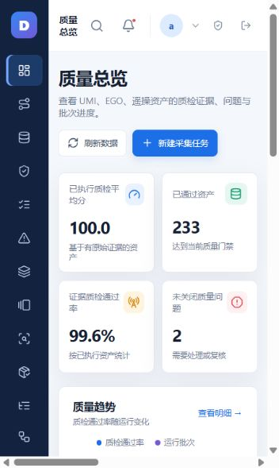

# 具身数据质量管控平台

面向 UMI、EGO 和遥操数据的本地数据质量管控平台，覆盖数据导入、服务端存储、证据质检、问题处置、Episode 标注与审核、批次验收及交付清单。

## 界面截图



## 运行要求

- Windows 10/11
- Node.js 18 或更高版本
- PowerShell 5.1 或更高版本
- LeRobot/Parquet 深度校验需要 Python 3.10+ 和 `pyarrow`

## 启动

```powershell
node .\serve.js
```

浏览器访问 `http://localhost:4173/`。

Windows 上也可以运行 `启动平台.bat`。该启动器会检查健康状态，并通过计划任务维持服务。若需要局域网访问，使用 `开启局域网访问.bat` 后，从同一网络的其他电脑访问本机局域网 IP 的 4173 端口。

## 数据与安全

生产数据保存在本机 `work/` 目录中，不纳入 Git。首次启动时在平台内创建管理员账号；账号密码只保存在服务端加盐哈希中。请勿把 `work/auth.json`、上传文件或服务端状态文件提交到公共仓库。

## 验证

```powershell
node --check serve.js
node --check assets\extensions.js
node --test tests\workflow-gates.test.js tests\workflow-api.test.js
```

LeRobot 数据深度校验脚本位于 `tools/lerobot_schema_check.py`，用于检查 Parquet 字段、行数、动作/观测列和 Episode 结构；平台不会把未通过真实校验的数据伪装成已验收状态。
