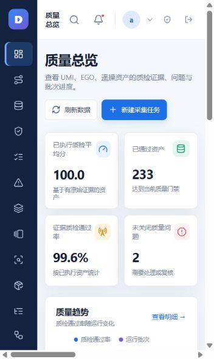

# 具身数据质量管控平台

面向 UMI、EGO 和遥操数据的本地数据质量管控平台，覆盖数据导入、服务端存储、证据质检、问题处置、任务指令标注与审核、批次验收及交付清单。

## 界面截图



## 运行要求

- Windows 10/11
- Node.js 18 或更高版本
- PowerShell 5.1 或更高版本
- LeRobot/Parquet 深度校验需要 Python 3.10+ 和 `pyarrow`

## 启动

```powershell
node .\serve.js
```

浏览器访问 `http://localhost:4173/`。

Windows 上也可以运行 `启动平台.bat`。该启动器会检查健康状态，并通过计划任务维持服务。若需要局域网访问，使用 `开启局域网访问.bat` 后，从同一网络的其他电脑访问本机局域网 IP 的 4173 端口。

## 数据与安全

生产数据保存在本机 `work/` 目录中，不纳入 Git。首次启动时在平台内创建管理员账号；账号密码只保存在服务端加盐哈希中。请勿把 `work/auth.json`、上传文件或服务端状态文件提交到公共仓库。

## 数据标注

标注以采集任务或数据集为单位，一个任务只维护一条任务指令，不再要求逐 Episode 重复标注。标注流程为：

1. 完成轨迹质检后，在“标注与审核”中按采集任务或数据集查看需要填写指令的范围。
2. 每个范围填写一条任务指令；同一任务下的全部 Episode 自动继承，不生成逐条填写页面。
3. 保存指令后提交一次审核；审核阶段只能填写意见，不能修改指令。
4. 审核通过后，该范围内的全部 Episode 同时满足标注门禁；退回后可修改并重新提交。
5. 导出时平台把任务指令展开到每个 Episode 的 `annotations.jsonl`，无需人工逐 Episode 操作。

资产带有 `taskId` 时按采集任务归组；尚未关联采集任务时按导入数据集（`bundleId`）归组。后续将资产绑定到同一采集任务后，一个任务可以覆盖多个数据包。

当前两个遥操数据集 `matching_cable1_joint` 和 `matching_cable8_joint` 统一使用：

> Connect all matching cable connectors on the table in the order of green, red, and then gray. If a color is not present, skip it and proceed to the next available color. For each available color, mate the matching connectors securely and place the connected pair into the basket. Continue until all connectors on the table have been connected and placed in the basket.

任务指令标注不包含逐 Episode 的执行结果、失败原因或动作分段；已有 Episode 标注记录仅作为兼容数据保留，不再参与门禁判断。

## 交付清单与多视角

一个生产批次只生成一份交付清单。服务端按 `bundleId` 校验唯一性，重复生成会直接返回已有清单，不会新增交付记录。导出入口必须先选择具体批次，不能把多个批次混入同一份清单。

遥操数据以 Episode 为逻辑数据条数：一个 `episode_XXXXXX.parquet` 及其全部相机视角共同组成一条数据。视角名称从 `meta/info.json` 的 `features` 中读取，例如 `observation.images.head`、`left`、`right`、`fourth`。只有某个 Episode 的声明视角全部存在时，才满足批次验收和交付门禁；Manifest 中会把 4 个 MP4 归入同一条 Episode，而不会按文件数重复计算数据条数。

视角数量不按 UMI、EGO 或遥操类型写死，而是从数据集自身检验：优先读取 `meta/info.json` 中 `features` 的视频字段；缺少该声明时，从同一数据集的 `videos/` 目录提取实际视角并建立该批次自己的视角集合。随后逐个 Episode 检查是否包含该集合，任一 Episode 缺视角都会进入“待补齐”，不能验收或交付。

### V6 多格式交付

在“导出与交付”选择已验收批次和目标格式。每个批次保留一份基础交付记录，可分别追加 LeRobot、MCAP、Zarr 产物。转换完成后提供经过 ZIP CRC 验证的下载包及 SHA-256；失败的转换不会登记为成功。

- LeRobot：v2.1 目录结构，保留全部 Parquet 列、视频和审核后的任务指令。
- MCAP：每个 Episode 一个 `.mcap`，按原时间戳写入 JSON 轨迹消息；原视频以独立文件随 ZIP 保留，MCAP 元数据记录相对路径。使用 `embodied-json` profile，不是 ROS/ROS2 bag，不包含解码后图像话题。
- Zarr：每个 Episode 一个 Zarr v2 group，数值列保存为数组，其余列以带编码说明的 JSON 字符串保存；原视频、元数据和审核指令随 ZIP 保留。不是所有训练框架通用的特定 Zarr 布局，消费者应按列名和属性读取。

MCAP 和 Zarr 当前接受已物化的 LeRobot v2.x 源。其他原始格式必须先成功生成完整 LeRobot 基础目录；不承诺任意源格式之间无损互转。转换逐 Episode 回读全部列值和时间戳，并验证视频 SHA-256。视频仅作字节保真校验，不代表已经通过完整解码质检。转换和 ZIP 会额外占用磁盘，需预留输出空间。

Python 依赖安装：

```powershell
.\runtime\python\Scripts\python.exe -m pip install -r tools\requirements-delivery.txt
```

部署时仅开放首页、`assets/` 和界面图片的静态访问；`work/`、`.git/` 及源码不作为静态文件公开。交付 ZIP 通过登录和角色鉴权后的 `/api/exports/<id>/package?format=mcap|zarr|lerobot` 下载。

### LeRobot 基础目录

基础交付目录采用 LeRobot v2.1。服务端会把所选批次物化到 `work/deliveries/<清单编号>/lerobot/`，保留 `meta/`、`data/` 和 `videos/` 结构，并记录源文件格式、视角数量与校验证据。MCAP、Zarr 产物存放在该记录的 `converted/` 子目录。

源数据已经是 LeRobot v2.x 时采用硬链接物化，不复制大文件也不丢失视频。非 LeRobot 源只能在插件确认不会丢弃视频流时转换；如果转换器会删除 `observation.images.*` 视频特征，平台会拒绝生成交付包，而不是产出一个缺视角的“伪 LeRobot”数据集。

## V6 流程模板

平台以 V6 作为生产流程模板，V5 和配音分支不再进入新流程。V6 模板覆盖采集接入、融合预处理、自动与人工质检、位姿准备与标注、裁剪/语义/翻译、跳过语义条件分支、交付打包和 LeRobot/MCAP/Zarr 输出。

每个节点记录执行类型和真实可用状态：

- `已完成`：平台已有真实证据。
- `待执行`：能力已接入，等待当前批次执行。
- `未接入`：算法、人工任务或转换器尚未接入，不能计入完成，也不能让批次伪装成 V6 完整闭环。

当前已接入的主要节点包括文件夹导入、自动质检、问题处置、任务指令标注、LeRobot 交付物化、MCAP/Zarr 转换、交付检测和批次验收；数据融合、脱敏、去畸变、点云、位姿/语义标注等节点仍处于待接入状态。MCAP/Zarr 节点仅在对应产物转换与回读校验成功后完成。

## 验证

```powershell
node --check serve.js
node --check assets\extensions.js
node --test tests\annotation-workflow.test.js tests\annotation-api.test.js tests\workflow-gates.test.js tests\workflow-api.test.js
node --test tests\delivery-api.test.js
.\runtime\python\Scripts\python.exe -m unittest discover -s tests -p test_delivery_convert.py -v
```

LeRobot 数据深度校验脚本位于 `tools/lerobot_schema_check.py`，用于检查 Parquet 字段、行数、动作/观测列和 Episode 结构；平台不会把未通过真实校验的数据伪装成已验收状态。
